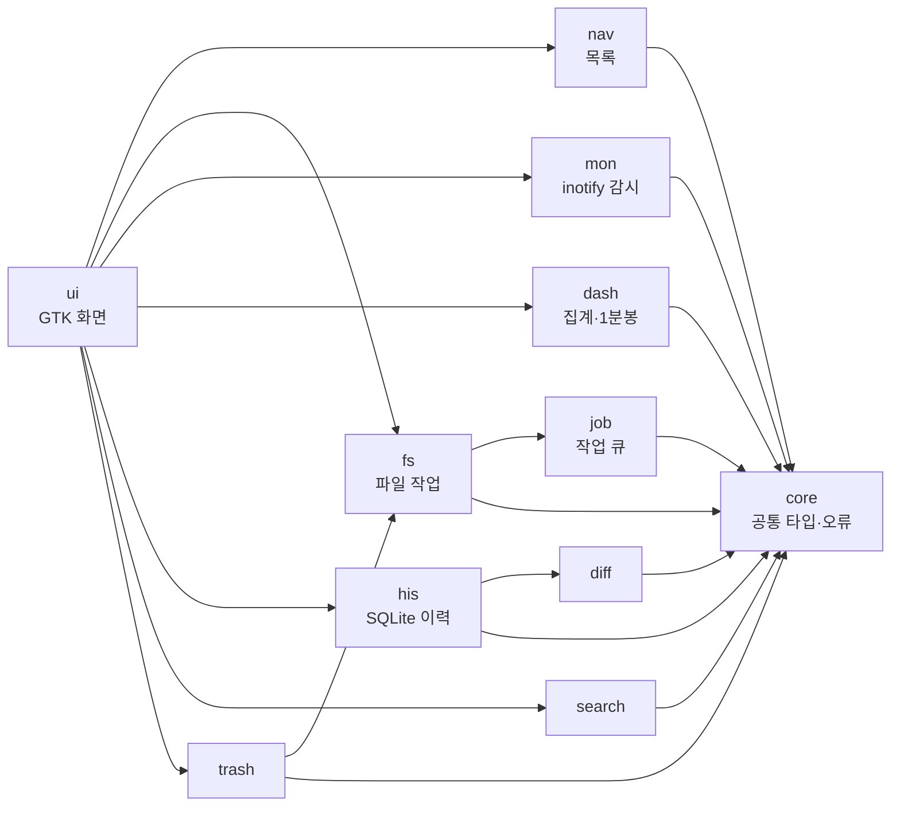

# FileScope

터미널이나 IDE에서 바뀐 파일을 새로고침 없이 바로 보여 주고, 바뀌기 전 버전으로 되돌릴 수 있는 Linux 파일 탐색기입니다. Ubuntu LTS에서 돌아가는 네이티브 GTK3 앱으로, C++17과 gtkmm-3.0으로 만들었습니다.

**진행 상태:** R2(이력·검색·미리보기·휴지통) 구현과 독립 QA까지 마쳤고, 실제 Ubuntu 수동 점검에서 나온 결함을 고치는 중입니다.

[](https://isocpp.org/)
[](https://www.gtkmm.org/)
[](https://www.sqlite.org/)
[](https://cmake.org/)
[](https://ubuntu.com/)

## 만들게 된 이유

개발하다 보면 빌드 도구, 에디터, 스크립트가 동시에 파일을 바꿉니다. 기본 파일 탐색기는 무엇이 언제 바뀌었는지 알려 주지 않고, 잘못 덮어쓴 파일은 git에 올리기 전이면 되돌릴 방법이 없습니다.

FileScope는 리눅스 커널의 inotify로 외부 변경을 받아 목록과 이벤트 로그에 바로 반영하고, 저장될 때마다 내용을 SQLite 이력에 남깁니다. 탐색, 변경 관측, 버전 비교와 복원을 한 화면에 묶는 것이 목표입니다.

일반 탐색은 Nautilus로 충분합니다. 이 프로젝트의 차별점은 이벤트 정규화(이동 연결, 대기열 넘침 뒤 재검사)와 버전 이력입니다. 자세한 문제 정의는 [PRD](docs/PRD.md)에 있습니다.

## 주요 기능

- **탐색과 파일 작업:** 탭, 뒤로·앞으로, 경로 입력, 새 파일·폴더, 복사·이동·이름 변경·삭제. 복사와 이동은 백그라운드 작업 큐에서 진행률과 함께 돌고, 이름이 겹치면 건너뛰기·둘 다 유지·덮어쓰기를 고릅니다.
- **실시간 감시:** 생성·수정·삭제·이동·속성 변경을 2초 안에 목록과 이벤트 로그에 보입니다. 이벤트 로그와 세션 집계는 지금 보고 있는 폴더 기준입니다.
- **변경량 1분봉:** 감시 폴더의 총용량을 주식 차트처럼 1분 캔들로 보여 주고, 생성·수정·삭제 건수를 거래량으로 쌓습니다.
- **자동 버전과 비교:** 파일이 저장될 때마다 버전을 남기고, 텍스트(md 포함)는 줄 단위 Diff, 이미지는 나란히 보기·겹쳐 밀기로 비교합니다.
- **되돌리기와 삭제 복구:** 고른 버전으로 되돌리기(확인 필요), 지워진 파일을 이력에서 원래 자리로 복원합니다.
- **트레이와 요약 창:** 창을 닫아도 감시를 이어 가고, 트레이 메뉴에서 요약 창 열기, 일시 정지, 종료를 합니다.
- **검색·휴지통·미리보기:** 이름 검색(링크 루프, 마운트 경계 처리), 시스템 휴지통 복원·비우기, 텍스트 미리보기와 편집(외부 수정 충돌 감지).

## 화면

화면 설계와 상태별 시안은 루트 [DESIGN.md](DESIGN.md)에 있습니다. 실제 Ubuntu 캡처는 수동 점검을 마친 뒤 이 절에 추가합니다.

## 기술 스택

| 구분 | 사용 기술 |
|---|---|
| 언어 | C++17, GCC(g++ 11·13·15) |
| UI | GTK3, gtkmm-3.0, libayatana-appindicator3(트레이) |
| 파일 감시 | inotify, GLib/GIO |
| 저장소 | SQLite 3(이력·이벤트), 내용 주소 블롭(`blobs/<앞 2자>/<SHA-256>`) |
| 빌드 | CMake 프리셋, Ninja, Make 래퍼 |
| 품질 | GLib 테스트, clang-format, clang-tidy, ASan·UBSan·TSan, Xvfb UI 자동화(AT-SPI) |

## 구조



- **모듈은 한 방향으로만 의존합니다.** ui만 GTK를 알고, 나머지 모듈은 순수 C++ 또는 GLib만 씁니다. 의존 규칙은 `make architecture`가 검사합니다. [ARCHITECTURE](docs/ARCHITECTURE.md), [ADR-0001](docs/adr/0001-architecture.md)
- **오류는 예외 대신 `Result`로 돌려줍니다.** 모든 공개 API가 오류 코드를 값으로 반환해 호출부가 실패를 무시할 수 없습니다. [ADR-0002](docs/adr/0002-error-model.md)
- **inotify 원시 이벤트는 정규화한 뒤 씁니다.** 이동은 cookie로 짝을 맞추고, 대기열이 넘치면 디렉터리를 다시 검사해 상태를 맞춥니다. [ADR-0003](docs/adr/0003-event-normalization.md)
- **파일 작업은 쓰기 전과 바꾸기 직전에 두 번 확인합니다.** 임시 파일에 쓴 뒤 rename하고, 링크를 따라가지 않으며, 보호 경로와 덮어쓰기는 명시적 확인이 있어야 합니다. [ADR-0005](docs/adr/0005-file-operation-safety.md)
- **이력은 SQLite와 내용 주소 블롭으로 나눕니다.** 같은 내용은 한 번만 저장하고, 강제 종료 뒤에도 무결성 검사와 고아 블롭 정리로 복구합니다. [ADR-0009](docs/adr/0009-history-persistence.md)

## 트러블슈팅

### 1. 트레이 호스트가 없는 데스크톱에서 시작하자마자 죽음

GNOME에서 AppIndicator 확장이 꺼져 있으면, 앱이 트레이 라이브러리 안에서 잘못된 메모리를 읽고 죽었습니다. ASan 빌드로 Wayland와 X11 모두 매번 재현됐습니다.

바꾼 내용은 다음과 같습니다.

- 아이콘 테마 검색 경로를 넘기던 방식(`app_indicator_new_with_path`, `set_icon_theme_path`)을 버리고, svg 아이콘의 절대 경로를 직접 넘기도록 바꿨습니다.
- 수정 전 3/3 재현, 수정 후 Wayland·X11 각 10회 실행에서 0회입니다.

### 2. 이력 종료 테스트가 30번에 한 번꼴로 실패

`/his/versions/shutdown` 테스트가 기준 스냅샷이 끝나기 전에 종료를 검사해 가끔 실패했습니다.

- 테스트에서 기준 스냅샷 대상 파일 크기 상한을 정해 스냅샷이 확실히 끝난 뒤 종료를 검사하게 했습니다.
- 컴파일러를 프리셋에서 `g++`로 고정했습니다.
- TSan 빌드로 200회 반복해 실패 0회를 확인했습니다.

### 3. 새 Ubuntu에서 빌드 실패

GCC 15와 libayatana-appindicator3 0.5.94가 들어간 새 Ubuntu에서는 트레이 생성 함수가 deprecated로 바뀌어, 경고를 오류로 처리하는 빌드(`-Werror`)가 멈췄습니다.

- `-Werror`는 유지하고, 트레이 호출 구간에만 `G_GNUC_BEGIN_IGNORE_DEPRECATIONS`로 경고를 국소적으로 껐습니다.
- 대체 라이브러리(libayatana-appindicator-glib)는 Ubuntu 24.04에 없어 전환하지 않았습니다.

### 4. 홈 폴더를 감시하면 이벤트가 끝없이 쌓임

이력 저장 폴더(`~/.local/share/filescope`)가 홈 아래에 있어서, 버전을 저장할 때 생기는 변경을 앱이 다시 감지했습니다.

- 이력 저장 폴더 아래 이벤트는 이벤트 로그, 세션 집계, 1분봉, 헤더 지표 어디에도 넣지 않습니다.
- UI 자동화 테스트에 이 폴더 변경이 0건으로 보이는지 확인하는 항목을 넣었습니다.

## 개발 방식

- **역할을 나눠 진행합니다.** Claude가 Coordinator로 요구사항을 작업 단위로 나누고 계약 문서를 관리하며, 구현은 Codex가 맡습니다. Coordinator는 보고가 아니라 실제 diff와 게이트 종료 코드로 판단합니다. [WORKFLOW](harness/WORKFLOW.md)
- **릴리스 단위로 독립 QA를 받습니다.** 구현 대화와 분리된 세션이 요구사항과 실제 diff를 기준으로 검증하고 PASS·FAIL·BLOCKED로 판정합니다. [R1 QA](docs/qa/r1-qa-report.md), [R2 QA](docs/qa/r2-qa-report.md)
- **작업 상태와 결정은 문서로 남깁니다.** 작업 지시와 수용 조건은 [TASKS](harness/TASKS.md), 진행 기록과 사용자 결정은 [PROGRESS](harness/PROGRESS.md)에 있습니다.

## 테스트

아래는 R2 묶음 QA(2026-11-26, WSL Ubuntu 24.04, GCC 13.3) 결과입니다.

| 검사 | 결과 |
|---|---|
| `make verify` (Debug·ASan·UBSan·TSan 빌드, 포맷, lint, 아키텍처, e2e) | 프리셋별 27/27 통과 |
| `make integration` | 6/6 통과 |
| `make stress` | 10,000건 / 10초(999건/초), 누락 없음. 이력 일괄 커밋 P95 5.4ms |
| `make benchmark` | 10만 파일 등록 0.25초. 이력 기준 스냅샷 2만 파일 34초, 그동안 조회 P95 4ms |
| `make ui-interaction` | Xvfb UI 자동화 20묶음 통과 |
| `make tsan` 10회 반복 | 10/10 통과 |

실제 Ubuntu 데스크톱이 필요한 항목(GNOME 트레이, 한국어 글꼴, 실제 편집기 저장, 화면 읽기)은 [R2 QA 보고서](docs/qa/r2-qa-report.md) 끝의 수동 점검 체크리스트로 확인합니다. 게이트 정의는 [TESTING](docs/TESTING.md)에 있습니다.

## 실행 방법

Ubuntu 22.04 이상, GCC, CMake, Ninja가 필요합니다.

```bash
sudo apt install build-essential cmake ninja-build pkg-config libgtk-3-dev libgtkmm-3.0-dev libsqlite3-dev libayatana-appindicator3-dev xvfb clang-format clang-tidy
git clone https://github.com/semicolon213/linux_file_system_extend.git
cd linux_file_system_extend
make build
./build/debug/filescope
```

| 명령 | 설명 |
|---|---|
| `make build` | Debug 빌드 |
| `make test` | 단위 테스트 |
| `make verify` | 전체 품질 게이트(네 가지 빌드, 포맷, lint, 아키텍처, e2e) |
| `make integration` | 실제 파일 시스템 통합 테스트 |
| `make stress` / `make benchmark` | 이벤트 부하, 대용량 폴더 성능 측정 |
| `make ui-interaction` | Xvfb에서 UI 자동화 테스트 |
| `make asan` / `make ubsan` / `make tsan` | 메모리·정의되지 않은 동작·스레드 경쟁 검사 |

- 의존성과 코딩 규칙: [ENGINEERING](docs/ENGINEERING.md)
- 트레이 아이콘은 GNOME에서 AppIndicator 확장(`ubuntu-appindicators@ubuntu.com`)이 켜져 있어야 보입니다. 꺼져 있으면 창을 닫을 때 앱이 종료됩니다.

## 아쉬운 점과 앞으로 할 것

- **수동 점검에서 나온 결함을 고치는 중입니다.** 큰 복사 취소, 덮어쓰기 2단계 확인, 다른 파일 시스템의 휴지통 이동 실패 표시, 감시하지 않는 폴더 자동 갱신, 감시 해제 버튼을 R2-F05로 묶어 진행합니다.
- **기준 스냅샷이 일부 오류에서 조용히 멈춥니다.** 권한 오류가 아닌 읽기 오류에서 스냅샷이 알림 없이 끝납니다. 데이터 손실은 없어 R3로 미뤘습니다.
- **R3 범위는 아직 정하지 않았습니다.** 후보는 디스크 사용량, 개발 도구 연동, 자동화, 백업과 docx·odt 내부 비교입니다. [PRD §3](docs/PRD.md)

## 문서

| 문서 | 내용 |
|---|---|
| [PRODUCT.md](PRODUCT.md) | 제품 맥락, 사용자, 차별점 |
| [docs/PRD.md](docs/PRD.md) | 왜, 무엇을, 릴리스 계획 |
| [docs/SRS.md](docs/SRS.md) | 기능·비기능 요구사항과 ID |
| [DESIGN.md](DESIGN.md) | 화면 설계(색, 글꼴, 배치, 상태) |
| [docs/DESIGN.md](docs/DESIGN.md) | 모듈 인터페이스와 데이터 계약 |
| [docs/ARCHITECTURE.md](docs/ARCHITECTURE.md) | 모듈 구조와 의존 규칙 |
| [docs/ENGINEERING.md](docs/ENGINEERING.md) | 빌드, 의존성, 코딩 규칙 |
| [docs/TESTING.md](docs/TESTING.md) | 품질 게이트와 측정 기록 |
| [docs/adr/](docs/adr/) | 설계 결정 기록 |
| [harness/](harness/) | 작업 지시, 진행 기록, 개발 절차 |

## 라이선스

라이선스는 아직 정하지 않았습니다. 그전까지 저작권은 저장소 소유자에게 있으며, 사용하거나 고쳐 쓰려면 저장소 이슈로 먼저 문의해 주세요.
